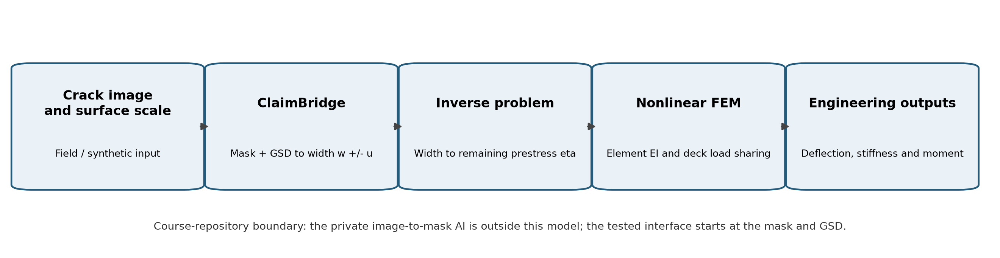
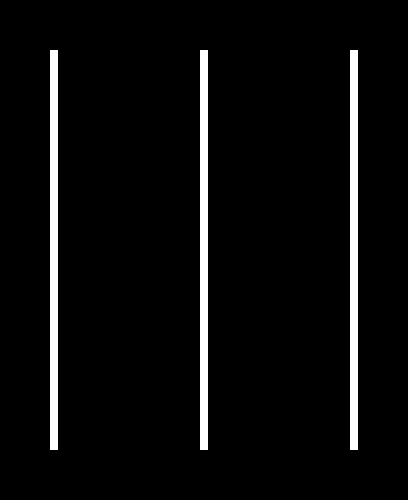

# ClaimBridge Background and FEM Interface Note

**Purpose.** This note gives the project supervisor enough background to understand what ClaimBridge contributes to the FEM course project, what crosses the software boundary, and how the resulting structural estimates should be interpreted. ClaimBridge is the author's private thesis inspection pipeline. The FEM repository does not expose or evaluate its private implementation.

## Main point

ClaimBridge and the FEM model perform different tasks. ClaimBridge converts an image-derived crack mask and a surface scale into a crack-width measurement with a resolution band. The FEM model then asks what remaining prestress and structural response would be consistent with that width under the adopted mechanical model. ClaimBridge is therefore the measurement tool; FEM supplies the structural interpretation.

The current evidence is a computational proof of concept. It uses synthetic masks and a stand-in bridge model. It demonstrates the complete interface and exposes the required image resolution, but it does not validate field-image accuracy or establish the capacity of a real bridge.

## 1 From thesis background to the FEM course deliverable

ClaimBridge existed before this course project as part of the author's thesis work on image-based bridge inspection. Its role is to turn an image-derived crack mask and a known surface scale into a measured crack width, a measurement band and a rule-engine rating. That work supplies the observation used by the course project; it is background rather than the FEM contribution being submitted.

The unresolved engineering question was what the measured width means for a prestressed bridge girder. A width and a condition category do not by themselves give the remaining prestress, the stiffness of the damaged member, its traffic deflection or the load transferred to neighbouring girders. The FEM project begins at this gap.

The project lineage is therefore:

**ClaimBridge thesis background → crack width w +/- u → inverse FEM → remaining prestress eta → nonlinear girder and grillage response → engineering outputs.**

The hand-over variable between the two projects is the measured crack width with its resolution band. ClaimBridge does not calculate eta or structural response, and the FEM model does not perform image segmentation. This separation allows each part to be examined on its own evidence.

The deliverables submitted to the FEM course are:

| FEM course deliverable | What is new in this project | Evidence in the package |
|---|---|---|
| Verified Stage 1 beam model | Beam elements, assembly, equivalent loads and secant stiffness for a prestressed composite girder | Source, closed-form and published-section checks; Stage 1 results |
| Inverse structural interpretation | Solve for eta whose predicted width agrees with ClaimBridge w +/- u | Inverse solver, Monte Carlo interval and measured-case table |
| Stage 2 nonlinear grillage | Five girder lines and transverse members with moment-dependent stiffness | Load redistribution, deflection, mesh and sensitivity results |
| Reproducible evidence package | Tests, JSON/CSV results, figures, sources, decisions and report | 401-test record, hashes and submission files |

The FEM submission is therefore not ClaimBridge itself. It is the structural-analysis layer built downstream of ClaimBridge, together with the numerical verification and engineering interpretation required by the course.

## 2 ClaimBridge in the thesis workflow

The intended inspection chain has four stages:

1. Acquire an image of the concrete surface and determine its scale.
2. Use the upstream AI to produce a pixel-level crack mask.
3. Quantify crack geometry and apply measurement-quality gates in ClaimBridge.
4. Pass the reported width and uncertainty to the structural model.

The course repository begins at Stage 2. Its live interface sends two files to the private pipeline:

- a PNG mask in which crack pixels have luminance above 127; and
- a surface JSON containing the image scale in metres per pixel and a reference to mapped surface data.

ClaimBridge returns a text report. The adapter parses the ground sampling distance, the minimum measurable width, the result for each crack, the maximum width in pixels and millimetres, the uncertainty, and the parallel DOH rule-engine rating. A result with an unknown or unrecognised gate fails closed: it is not silently treated as a usable width.

*Figure 1. Data boundary and workflow. The upstream image-to-mask AI is private and outside the course repository. The reproducible course evidence starts with the mask and GSD.*

## 3 Interface contract

| Item | Form used in this project | Engineering meaning |
|---|---|---|
| Crack mask | Binary-like PNG, crack pixels above luminance 127 | Geometry supplied to ClaimBridge; synthetic in the present tests |
| Surface scale | GSD in mm/px | Converts a pixel distance into a physical distance |
| Resolution gate | Minimum measurable width = 3 GSD | Widths below three pixels are refused rather than reported as precise measurements |
| Width result | Maximum accepted width, w, in mm | Governing measured crack passed to the inverse FEM analysis |
| Measurement band | u = 2 GSD | Pixel-resolution band reported with w; not a complete uncertainty budget |
| Rule-engine result | DOH category and label | Existing categorical interpretation, retained for comparison |

If every crack is refused only because it is below the measurable-resolution gate, the FEM code can use that refusal only as a bound. If any crack is unresolved for another reason, the code returns no governing width because the unresolved crack may be the widest one. This choice avoids biasing the width downward and the inferred remaining prestress upward.

## 4 Why image scale matters

GSD is the physical size represented by one image pixel. For a GSD of 0.02 mm/px, an eight-pixel crack corresponds to 0.16 mm. At 0.38 mm/px, the same physical crack occupies less than one pixel and cannot satisfy the three-pixel measurement gate.

| GSD mm/px | Three-pixel gate mm | Reported band u = 2 GSD mm | Interpretation in this project |
|---:|---:|---:|---|
| 0.02 | 0.06 | 0.04 | Suitable for the synthetic crack widths used in Cases 2 and 3 |
| 0.05 | 0.15 | 0.10 | Case 2 is at the gate; Case 3 remains measurable |
| 0.10 | 0.30 | 0.20 | Only the wider Case 3 crack is measurable |
| 0.38 | 1.14 | 0.76 | None of the modelled cracks is measurable |

Published image-based crack studies support the need to treat spatial scale, calibration and segmentation boundaries as measurement issues rather than cosmetic details. Yang et al. used camera calibration and geometric transformation to address perspective and lens effects; Bae and An combined semantic segmentation with distance-transform quantification and reported field-validation differences; Yu et al. reported maximum-width error in pixels for a segmentation and medial-axis method. These studies provide context for the interface, but they do not validate ClaimBridge itself.

## 5 Connection to the FEM model

The measured quantity is crack width w. The structural unknown is the remaining-prestress ratio:

**eta = effective prestress remaining / design effective prestress.**

The forward model calculates a predicted crack width w_pred(eta). The inverse analysis searches for the value of eta whose predicted width agrees with the ClaimBridge measurement. That eta is then used in the nonlinear secant-stiffness FEM analysis to estimate element stiffness, moment redistribution and truck deflection.

Two structural models are retained deliberately:

- **Stage 1 single girder:** an Euler-Bernoulli beam that exposes the complete measurement-to-mechanics chain and is easy to verify against closed-form results.
- **Stage 2 grillage:** five longitudinal girders connected by transverse members, allowing a damaged girder to shed load to its neighbours.

The same measured width may therefore give different eta values. This is expected because eta is a model-conditional inference, not a quantity measured directly by ClaimBridge.

## 6 Worked interface example

Case 2 was generated with a Stage 1 model width of 0.1612 mm. At GSD 0.02 mm/px, the synthetic mask contains an eight-pixel-wide crack. ClaimBridge reports 0.16 +/- 0.04 mm and the DOH rule engine assigns rating 5, Excellent.

*Figure 2. Synthetic interface fixture. The straight constant-width bars test the file boundary and resolution rules; they are not field-image validation data.*

The inverse FEM result depends on the chosen structural representation:

| Model receiving the same measured width | eta 5th percentile | eta median | eta 95th percentile |
|---|---:|---:|---:|
| Stage 1 single girder | 0.338 | 0.361 | 0.385 |
| Stage 2 grillage, exterior G1 damaged | 0.263 | 0.287 | 0.314 |
| Stage 2 grillage, interior G3 damaged | 0.330 | 0.353 | 0.378 |

The exterior-girder result is lower because a softened G1 sheds part of its load to adjacent girders. The single-girder model cannot represent that redistribution. This comparison is one reason the grillage is the main engineering result while Stage 1 remains the transparent verification model.

## 7 Uncertainty and validity

For the present analysis, the ClaimBridge band is read as a coverage-factor k = 2 convention, so sigma = u/2. A truncated normal distribution is sampled for positive crack widths, and the reported eta interval is the 5th to 95th percentile of successful inversions. This band includes measurement-resolution noise only. It does not include uncertainty in bridge geometry, material properties, prestress-loss history, crack cause, model form or AI segmentation accuracy.

- **Synthetic consistency:** the current masks were generated from widths predicted by the Stage 1 model. Recovering similar values checks the software chain but is not independent validation.
- **Measurement validation:** field images, physical crack-gauge measurements and documented camera geometry are still required to assess ClaimBridge accuracy.
- **Structural validation:** as-built drawings and independent engineering checks are required before interpreting eta as a bridge condition or using the results for load rating.
- **Causal ambiguity:** a crack open at rest may reflect reduced precompression under the adopted model, but residual opening after an overload or another crack mechanism could produce a similar observation.

## 8 Evidence available to the supervisor

The submission package contains:

- committed parsed ClaimBridge outputs for twelve synthetic mask and GSD combinations;
- the file-only adapter and fail-closed output parser in `src/crackfem/claimbridge.py`;
- the uncertainty implementation in `src/crackfem/uq.py`;
- Stage 1 and Stage 2 result files and figures;
- automated tests, including live-pipeline tests when the private local configuration is present; and
- a run record containing result hashes and the captured test outcome.

The private ClaimBridge repository is not required to reproduce the FEM results because the parsed pipeline outputs are committed. It is required only to rerun the live measurement interface.

## 9 Recommended interpretation

> ClaimBridge supplies a resolution-aware crack-width measurement. The FEM model converts that measurement into a conditional estimate of remaining prestress and structural response. The present project verifies the software and mechanics chain on synthetic inputs and identifies the image resolution needed for future field validation.

The present results should be described as a screening indicator and research prototype, not a bridge capacity assessment or a validated diagnosis from field imagery.

## References

1. ClaimBridge thesis inspection pipeline, private project documentation and interface outputs used by this repository, accessed 18 October 2026.
2. Yang, Y.-S., Wu, C.-L., Hsu, T. T. C., Yang, H.-C., Lu, H.-J., and Chang, C.-C. (2018). "Image analysis method for crack distribution and width estimation for reinforced concrete structures." *Automation in Construction*, 91, 120-132. https://doi.org/10.1016/j.autcon.2018.03.012
3. Bae, H., and An, Y.-K. (2023). "Computer vision-based statistical crack quantification for concrete structures." *Measurement*, 211, 112632. https://doi.org/10.1016/j.measurement.2023.112632
4. Yu, Z., Shen, Y., Sun, Z., Chen, J., and Gang, W. (2022). "Cracklab: A high-precision and efficient concrete crack segmentation and quantification network." *Developments in the Built Environment*, 12, 100088. https://doi.org/10.1016/j.dibe.2022.100088
5. Project source register: `docs/sources.md`, especially S08-S10 for crack and stiffness mechanics, S22-S27 for the grillage model, and S28-S30 for image-based crack measurement context.

